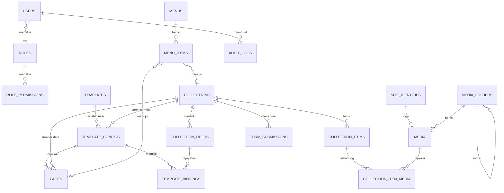

# Dokumen Schema Sistem Web Profil Pendidikan

Dokumen ini menjelaskan rancangan lengkap sistem web profil pendidikan (sekolah, madrasah, kampus, atau lembaga kursus), mulai dari konsep data, tabel database, relasi, struktur folder, komponen UI, sidebar admin, hingga alur kerja modul seperti Berita dan PPDB.

---

## 1. Ringkasan dan Tujuan

Sistem ini dirancang agar:

1. Identitas lembaga dapat dikelola tanpa perlu mengubah kode.
2. Konten dinamis (berita, galeri, PPDB, guru, fasilitas, agenda) dapat dibuat sendiri dari admin tanpa developer.
3. Tampilan halaman dapat diubah lewat konfigurasi, bukan dengan menulis ulang komponen.
4. Data konten dan tampilan saling terhubung secara otomatis melalui sistem *binding* (pengikatan key).
5. Setiap komponen UI dapat memiliki banyak varian desain yang bisa dipilih dari database.

---

## 2. Evaluasi Rancangan Awal

Rancangan awal sudah memiliki fondasi yang baik. Beberapa hal yang perlu dipertegas agar lebih profesional:

| Aspek | Rancangan Awal | Rekomendasi |
|---|---|---|
| Identitas | Data utama yang jarang berubah | Dibuat sebagai *singleton* (satu baris), dengan kolom yang jelas dan terstruktur |
| Media | Penyimpan file | Ditambah metadata, folder, dan deduplikasi berdasarkan checksum |
| Collection | Data statis dan dinamis | Dipisah antara **definisi** koleksi (`collections`, `collection_fields`) dan **isi** data (`collection_items`) |
| Template | Data template | Dipisah menjadi **Template** (blueprint/jenis tampilan) dan **Template Config** (instansi desain yang dipakai halaman) |
| Hubungan Template Config dan Collection | Saling terkait lewat key | Dibuat eksplisit lewat tabel `template_bindings` agar validasi dan otomatisasi mudah dilacak |
| Navigasi | Belum dijelaskan | Ditambahkan tabel `menus` dan `menu_items` |
| Halaman | Belum dijelaskan | Ditambahkan tabel `pages` untuk halaman statis maupun halaman dinamis |
| Form PPDB | Belum dijelaskan | Ditambahkan `form_submissions` untuk menyimpan data pendaftar |
| Keamanan | Belum dijelaskan | Ditambahkan `users`, `roles`, `role_permissions`, dan `audit_logs` |

---

## 3. Stack dan Prinsip Teknis

| Lapisan | Teknologi | Keterangan |
|---|---|---|
| Framework | Next.js (App Router) | Rendering halaman publik dengan SSG/ISR, admin dengan Server Components dan Server Actions |
| Styling | Tailwind CSS v4 | Konfigurasi token lewat `@theme` di CSS |
| Komponen UI | shadcn/ui (dikustomisasi) | Setiap komponen memiliki folder sendiri dengan banyak varian |
| Database | PostgreSQL | Mendukung JSONB untuk data dinamis dan indeks GIN |
| ORM | Prisma atau Drizzle | Memudahkan migrasi dan relasi |
| Validasi | Zod | Dipakai bersama antara client, server action, dan definisi field |
| Form | React Hook Form + Zod resolver | Form admin dan form PPDB |
| Tabel admin | TanStack Table | Daftar item, media, dan pengguna |
| Penyimpanan file | Local (dev) lalu S3 atau Cloudinary (produksi) | Dibungkus dalam satu *storage adapter* |
| Autentikasi | Auth.js atau Better Auth | Login admin dan manajemen sesi |
| Cache | `revalidateTag` / `revalidatePath` | Halaman publik diperbarui otomatis saat konten berubah |

### Prinsip Desain Data

1. **Pisahkan definisi dan isi.** Definisi (koleksi, field, template) jarang berubah. Isi (berita, item galeri) sering berubah.
2. **Gunakan slug dan key yang stabil.** Key bersifat `snake_case`, unik per koleksi, dan tidak boleh diubah setelah dipakai.
3. **Soft delete** untuk data konten dan media, sehingga bisa dipulihkan.
4. **Setiap tabel memiliki** `id`, `created_at`, `updated_at`. Tabel yang bisa dihapus juga memiliki `deleted_at`.
5. **ID menggunakan UUID atau CUID2**, bukan auto increment, agar mudah dipakai saat ekspor dan impor.

---

## 4. Konsep Inti

| Entitas | Peran | Sifat | Contoh |
|---|---|---|---|
| **Identitas** | Data utama lembaga | Hampir tetap (singleton) | Nama sekolah, NPSN, alamat, logo, kontak |
| **Media** | Penyimpanan file yang bisa dipakai ulang | Dinamis | Gambar, video, PDF, dokumen |
| **Collection** | Wadah data berstruktur (definisi + isi) | Statis atau dinamis | Berita, Galeri, PPDB, Guru, Fasilitas |
| **Template** | Blueprint tampilan (kode komponen) | Jarang berubah | `berita-list`, `berita-detail`, `hero-banner` |
| **Template Config** | Instansi desain yang dipakai halaman | Sering berubah | Warna, varian, layout, dan binding ke collection |
| **Page** | Halaman publik | Dinamis | Profil, Visi Misi, halaman berita |
| **Menu** | Navigasi header, footer, dan sidebar | Dinamis | Menu utama, menu footer |

### Perbedaan Template dan Template Config

Ini adalah bagian yang paling sering membingungkan, jadi perlu dipahami dengan jelas:

- **Template** adalah *jenis* tampilan. Contoh: "Halaman detail berita" adalah satu template. Template ini dibuat oleh developer dalam bentuk komponen React.
- **Template Config** adalah *konfigurasi* dari template tersebut. Contoh: "Halaman detail berita untuk SMA, warna biru, varian *hero-with-sidebar*, judul diambil dari field `judul`". Satu template bisa memiliki banyak template config.

Dengan pemisahan ini, admin cukup memilih template dan mengatur konfigurasinya tanpa menyentuh kode.

---

## 5. Diagram Relasi Entitas



---

## 6. Detail Tabel Database

Tipe data mengacu pada PostgreSQL. `uuid` berarti UUID v7 atau CUID2.

### 6.1 `users`

Akun admin dan editor.

| Kolom | Tipe | Null | Keterangan |
|---|---|---|---|
| `id` | uuid | tidak | Primary key |
| `name` | varchar(120) | tidak | Nama lengkap |
| `email` | varchar(180) | tidak | Unik |
| `password_hash` | text | ya | Kosong jika login via provider |
| `role_id` | uuid | tidak | FK ke `roles.id` |
| `avatar_media_id` | uuid | ya | FK ke `media.id` |
| `is_active` | boolean | tidak | Default `true` |
| `last_login_at` | timestamptz | ya | |
| `created_at` | timestamptz | tidak | |
| `updated_at` | timestamptz | tidak | |
| `deleted_at` | timestamptz | ya | Soft delete |

Indeks: unik pada `email`, indeks pada `role_id`.

### 6.2 `roles` dan `role_permissions`

| Tabel | Kolom | Keterangan |
|---|---|---|
| `roles` | `id`, `slug`, `name`, `description`, `is_system` | `slug` contoh: `superadmin`, `admin`, `editor`, `kontributor`, `viewer`. `is_system` mencegah role bawaan dihapus |
| `role_permissions` | `id`, `role_id`, `permission_key`, `created_at` | `permission_key` contoh: `identitas.update`, `collection.items.publish`, `media.upload` |

Kombinasi unik: `(role_id, permission_key)`.

### 6.3 `site_identities`

Data utama lembaga. Hanya memiliki satu baris. Untuk memastikan itu, gunakan kolom `singleton_key` bernilai tetap `'main'` dengan constraint unik.

| Kolom | Tipe | Null | Keterangan |
|---|---|---|---|
| `id` | uuid | tidak | Primary key |
| `singleton_key` | varchar(10) | tidak | Nilai tetap `main`, unik |
| `nama_lembaga` | varchar(200) | tidak | Nama lengkap |
| `nama_singkat` | varchar(60) | ya | Contoh: SMAN 1 Contoh |
| `jenjang` | enum | ya | `tk`, `sd`, `smp`, `sma`, `smk`, `mi`, `mts`, `ma`, `pt`, `kursus`, `lainnya` |
| `status_lembaga` | enum | ya | `negeri`, `swasta` |
| `npsn` | varchar(20) | ya | |
| `nss` | varchar(20) | ya | |
| `akreditasi` | varchar(10) | ya | Contoh: A, B, C |
| `tahun_berdiri` | smallint | ya | |
| `slogan` | varchar(255) | ya | |
| `visi` | text | ya | |
| `misi` | jsonb | ya | Array string |
| `sejarah_singkat` | text | ya | |
| `alamat` | text | ya | |
| `kelurahan`, `kecamatan`, `kota`, `provinsi` | varchar(120) | ya | |
| `kode_pos` | varchar(10) | ya | |
| `latitude`, `longitude` | numeric(10,7) | ya | Untuk peta |
| `telepon` | varchar(30) | ya | |
| `email` | varchar(180) | ya | |
| `whatsapp` | varchar(30) | ya | |
| `website` | varchar(255) | ya | |
| `kepala_lembaga` | varchar(120) | ya | |
| `sosial_media` | jsonb | ya | Contoh: `{"instagram":"...","youtube":"..."}` |
| `jam_operasional` | jsonb | ya | Array per hari |
| `logo_media_id` | uuid | ya | FK ke `media.id` |
| `favicon_media_id` | uuid | ya | FK ke `media.id` |
| `hero_media_id` | uuid | ya | FK ke `media.id` |
| `updated_by` | uuid | ya | FK ke `users.id` |
| `created_at`, `updated_at` | timestamptz | tidak | |

### 6.4 `media_folders`

| Kolom | Tipe | Null | Keterangan |
|---|---|---|---|
| `id` | uuid | tidak | |
| `parent_id` | uuid | ya | FK ke `media_folders.id`, untuk struktur bertingkat |
| `name` | varchar(120) | tidak | |
| `slug` | varchar(140) | tidak | |
| `created_at`, `updated_at` | timestamptz | tidak | |

### 6.5 `media`

Penyimpanan file yang bisa dipakai ulang di banyak tempat.

| Kolom | Tipe | Null | Keterangan |
|---|---|---|---|
| `id` | uuid | tidak | |
| `folder_id` | uuid | ya | FK ke `media_folders.id` |
| `kind` | enum | tidak | `image`, `video`, `document`, `audio`, `other` |
| `storage_provider` | enum | tidak | `local`, `s3`, `cloudinary` |
| `storage_key` | text | tidak | Path atau key di storage |
| `public_url` | text | tidak | |
| `original_name` | varchar(255) | tidak | |
| `mime_type` | varchar(120) | tidak | |
| `extension` | varchar(20) | tidak | |
| `size_bytes` | bigint | tidak | |
| `checksum_sha256` | char(64) | ya | Untuk mendeteksi file duplikat |
| `width`, `height` | integer | ya | Untuk gambar dan video |
| `duration_seconds` | integer | ya | Untuk video dan audio |
| `title` | varchar(200) | ya | |
| `alt_text` | varchar(255) | ya | Wajib untuk gambar yang tampil publik |
| `caption` | text | ya | |
| `variants` | jsonb | ya | Contoh: `{"thumb":"...","md":"...","webp":"..."}` |
| `uploaded_by` | uuid | ya | FK ke `users.id` |
| `created_at`, `updated_at`, `deleted_at` | timestamptz | | |

Indeks: `checksum_sha256`, `folder_id`, `kind`.

### 6.6 `collection_item_media`

Tabel penghubung antara item koleksi dan media. Dipisah dari `collection_items` agar satu item bisa memiliki banyak media dan satu media bisa dipakai di banyak item.

| Kolom | Tipe | Null | Keterangan |
|---|---|---|---|
| `id` | uuid | tidak | |
| `item_id` | uuid | tidak | FK ke `collection_items.id` |
| `media_id` | uuid | tidak | FK ke `media.id` |
| `field_key` | varchar(80) | tidak | Key field tempat media dipakai, contoh `gambar_utama` |
| `sort_order` | integer | tidak | Default 0 |
| `created_at` | timestamptz | tidak | |

Kombinasi unik: `(item_id, field_key, media_id)`.

### 6.7 `collections`

Definisi koleksi. Setiap jenis konten adalah satu baris di sini.

| Kolom | Tipe | Null | Keterangan |
|---|---|---|---|
| `id` | uuid | tidak | |
| `slug` | varchar(80) | tidak | Unik. Contoh: `berita`, `ppdb`, `galeri`, `guru` |
| `nama` | varchar(120) | tidak | Contoh: "Berita Sekolah" |
| `deskripsi` | text | ya | |
| `kind` | enum | tidak | `static` (data jarang berubah, contoh: fasilitas) atau `dynamic` (sering berubah, contoh: berita) |
| `mode` | enum | tidak | `content` (dikelola admin), `form` (menerima input publik seperti PPDB), `hybrid` |
| `has_public_detail` | boolean | tidak | Apakah item punya halaman detail sendiri |
| `url_prefix` | varchar(80) | ya | Contoh: `/berita`. Digunakan untuk routing publik |
| `default_list_template_config_id` | uuid | ya | FK ke `template_configs.id` |
| `default_detail_template_config_id` | uuid | ya | FK ke `template_configs.id` |
| `is_active` | boolean | tidak | |
| `sort_order` | integer | tidak | Urutan di sidebar |
| `created_at`, `updated_at`, `deleted_at` | timestamptz | | |

### 6.8 `collection_fields`

Definisi key dan value. Ini adalah "skema" dari setiap koleksi, sehingga admin dapat membuat field sendiri.

| Kolom | Tipe | Null | Keterangan |
|---|---|---|---|
| `id` | uuid | tidak | |
| `collection_id` | uuid | tidak | FK ke `collections.id` |
| `key` | varchar(80) | tidak | Snake case, unik per koleksi. Contoh: `judul`, `gambar_utama` |
| `label` | varchar(120) | tidak | Label untuk admin |
| `field_type` | enum | tidak | Lihat tabel tipe field di bagian 9 |
| `is_required` | boolean | tidak | Default `false` |
| `is_unique` | boolean | tidak | Default `false` |
| `is_searchable` | boolean | tidak | Masuk indeks pencarian |
| `is_filterable` | boolean | tidak | Bisa dijadikan filter di daftar |
| `is_listed` | boolean | tidak | Tampil di tabel admin |
| `default_value` | jsonb | ya | |
| `options` | jsonb | ya | Untuk `select` atau `multiselect` |
| `validation` | jsonb | ya | Contoh: `{"min":3,"max":120,"pattern":"..."}` |
| `help_text` | text | ya | |
| `sort_order` | integer | tidak | |
| `created_at`, `updated_at` | timestamptz | tidak | |

Kombinasi unik: `(collection_id, key)`.

Catatan: key yang sudah dipakai oleh template binding tidak boleh dihapus. Sistem harus menampilkan peringatan dan meminta admin memperbarui binding terlebih dahulu.

### 6.9 `collection_items`

Isi data koleksi. Nilai dinamis disimpan dalam kolom `data` bertipe JSONB berbentuk pasangan key dan value.

| Kolom | Tipe | Null | Keterangan |
|---|---|---|---|
| `id` | uuid | tidak | |
| `collection_id` | uuid | tidak | FK ke `collections.id` |
| `slug` | varchar(200) | tidak | Unik per koleksi. Dibuat otomatis dari judul |
| `data` | jsonb | tidak | Pasangan key dan value sesuai `collection_fields` |
| `status` | enum | tidak | `draft`, `scheduled`, `published`, `archived` |
| `published_at` | timestamptz | ya | |
| `scheduled_at` | timestamptz | ya | Untuk penjadwalan publikasi |
| `template_config_id` | uuid | ya | Override template untuk item ini. Jika kosong, pakai default koleksi |
| `seo_title` | varchar(70) | ya | |
| `seo_description` | varchar(180) | ya | |
| `seo_og_media_id` | uuid | ya | FK ke `media.id` |
| `sort_order` | integer | ya | Untuk koleksi statis |
| `created_by` | uuid | ya | FK ke `users.id` |
| `updated_by` | uuid | ya | FK ke `users.id` |
| `created_at`, `updated_at`, `deleted_at` | timestamptz | | |

Indeks:
- Unik `(collection_id, slug)`.
- Indeks `(collection_id, status, published_at DESC)` untuk daftar publik.
- GIN indeks pada `data` untuk pencarian.
- Indeks ekspresi untuk field yang sering difilter, contoh: `((data->>'kategori'))`. Dibuat otomatis hanya untuk field yang bertanda `is_filterable`.

### 6.10 `templates`

Blueprint tampilan. Isinya merupakan metadata dari komponen yang ada di kode. Tabel ini bersifat registry yang disinkronkan dari kode.

| Kolom | Tipe | Null | Keterangan |
|---|---|---|---|
| `id` | uuid | tidak | |
| `key` | varchar(120) | tidak | Unik. Contoh: `berita.detail`, `hero.banner` |
| `nama` | varchar(120) | tidak | |
| `deskripsi` | text | ya | |
| `category` | enum | tidak | `page`, `section`, `list`, `detail`, `widget`, `layout` |
| `component_key` | varchar(160) | tidak | Kunci untuk mencari komponen di registry kode |
| `schema` | jsonb | tidak | Daftar slot yang dibutuhkan template beserta tipe yang diterima |
| `available_variants` | jsonb | tidak | Contoh: `["default","bordered","minimal"]` |
| `default_config` | jsonb | ya | Nilai awal saat template config dibuat |
| `thumbnail_media_id` | uuid | ya | FK ke `media.id` |
| `version` | integer | tidak | Naik jika kode template berubah |
| `is_system` | boolean | tidak | Template bawaan, tidak boleh dihapus |
| `is_active` | boolean | tidak | |
| `created_at`, `updated_at` | timestamptz | tidak | |

Contoh isi `schema`:

```json
{
  "slots": [
    { "key": "judul", "type": "text", "required": true },
    { "key": "gambar", "type": "media", "required": false },
    { "key": "ringkasan", "type": "textarea", "required": false },
    { "key": "isi", "type": "richtext", "required": true },
    { "key": "meta", "type": "fields", "fields": ["tanggal_terbit", "penulis"] }
  ]
}
```

### 6.11 `template_configs`

Instansi desain yang dipakai halaman atau koleksi. Di sinilah admin mengatur warna, varian, layout, dan binding.

| Kolom | Tipe | Null | Keterangan |
|---|---|---|---|
| `id` | uuid | tidak | |
| `template_id` | uuid | tidak | FK ke `templates.id` |
| `name` | varchar(120) | tidak | Contoh: "Berita Detail - Biru" |
| `scope` | enum | tidak | `global`, `page`, `collection_list`, `collection_detail` |
| `collection_id` | uuid | ya | FK ke `collections.id`. Wajib jika scope berkaitan koleksi |
| `variant` | varchar(80) | tidak | Contoh: `hero-with-sidebar`. Harus ada di `available_variants` |
| `design` | jsonb | tidak | Detail desain (lihat contoh di bagian 7) |
| `slots` | jsonb | tidak | Mapping slot ke field atau nilai statis |
| `is_default` | boolean | tidak | Default untuk template dan scope yang sama |
| `version` | integer | tidak | Naik setiap kali disimpan (untuk rollback) |
| `created_by` | uuid | ya | FK ke `users.id` |
| `created_at`, `updated_at` | timestamptz | tidak | |

### 6.12 `template_bindings`

Tabel hasil sinkronisasi otomatis antara `template_configs.slots` dan `collection_fields`. Tabel ini memastikan setiap key di template terhubung ke field yang benar, dan mencatat jika ada yang rusak.

| Kolom | Tipe | Null | Keterangan |
|---|---|---|---|
| `id` | uuid | tidak | |
| `template_config_id` | uuid | tidak | FK ke `template_configs.id` |
| `slot_key` | varchar(80) | tidak | Key slot di template. Contoh: `judul` |
| `collection_field_id` | uuid | ya | FK ke `collection_fields.id`. Kosong jika nilai statis |
| `static_value` | jsonb | ya | Untuk nilai tetap, tanpa field |
| `status` | enum | tidak | `ok`, `missing_field`, `type_mismatch`, `required_empty` |
| `synced_at` | timestamptz | tidak | |

Kombinasi unik: `(template_config_id, slot_key)`.

### 6.13 `pages`

Halaman publik. Halaman statis (Profil, Visi Misi) dan halaman yang menampilkan koleksi (daftar berita) sama-sama disimpan di sini.

| Kolom | Tipe | Null | Keterangan |
|---|---|---|---|
| `id` | uuid | tidak | |
| `parent_id` | uuid | ya | Untuk halaman bertingkat |
| `type` | enum | tidak | `static`, `collection_list`, `collection_detail`, `landing`, `system` |
| `title` | varchar(200) | tidak | |
| `slug` | varchar(200) | tidak | Unik per parent |
| `full_path` | varchar(500) | tidak | Contoh: `/profil/visi-misi`. Unik, dihitung otomatis |
| `template_config_id` | uuid | ya | FK ke `template_configs.id` |
| `collection_id` | uuid | ya | Untuk `collection_list` dan `collection_detail` |
| `content` | jsonb | ya | Isi blok untuk halaman statis |
| `status` | enum | tidak | `draft`, `published`, `archived` |
| `seo_title`, `seo_description` | varchar | ya | |
| `seo_og_media_id` | uuid | ya | FK ke `media.id` |
| `robots` | varchar(60) | ya | Contoh: `index,follow` |
| `is_protected` | boolean | tidak | Halaman sistem yang tidak boleh dihapus |
| `published_at` | timestamptz | ya | |
| `created_at`, `updated_at`, `deleted_at` | timestamptz | | |

### 6.14 `menus` dan `menu_items`

| Tabel | Kolom penting | Keterangan |
|---|---|---|
| `menus` | `id`, `key`, `nama`, `location` | `key` contoh: `main`, `footer`. `location` enum: `header`, `footer`, `sidebar_public`, `mobile` |
| `menu_items` | `id`, `menu_id`, `parent_id`, `label`, `link_type`, `page_id`, `collection_id`, `external_url`, `icon`, `is_visible`, `open_in_new_tab`, `sort_order` | `link_type` enum: `page`, `collection`, `external`, `anchor`, `none` |

Hanya salah satu dari `page_id`, `collection_id`, `external_url` yang terisi, sesuai `link_type`. Validasi ini dilakukan di aplikasi dan dengan constraint CHECK.

### 6.15 `form_submissions`

Menyimpan data yang dikirim publik, misalnya pendaftaran PPDB.

| Kolom | Tipe | Null | Keterangan |
|---|---|---|---|
| `id` | uuid | tidak | |
| `collection_id` | uuid | tidak | FK ke `collections.id` dengan `mode = form` |
| `reference_code` | varchar(40) | tidak | Kode pendaftaran unik untuk dilacak pendaftar |
| `data` | jsonb | tidak | Pasangan key dan value sesuai `collection_fields` |
| `status` | enum | tidak | `new`, `reviewing`, `accepted`, `rejected`, `waiting_list`, `archived` |
| `status_note` | text | ya | Catatan internal |
| `contact_email` | varchar(180) | ya | Diambil dari field bertanda `is_contact_email` |
| `contact_phone` | varchar(30) | ya | |
| `ip_hash` | char(64) | ya | Hash IP untuk anti spam, bukan IP asli |
| `user_agent` | varchar(255) | ya | |
| `reviewed_by` | uuid | ya | FK ke `users.id` |
| `reviewed_at` | timestamptz | ya | |
| `submitted_at` | timestamptz | tidak | |
| `created_at`, `updated_at` | timestamptz | tidak | |

### 6.16 `settings`

Pengaturan sistem yang tidak termasuk identitas lembaga.

| Kolom | Tipe | Null | Keterangan |
|---|---|---|---|
| `id` | uuid | tidak | |
| `group` | varchar(60) | tidak | Contoh: `general`, `seo`, `integration`, `mail` |
| `key` | varchar(120) | tidak | Unik per group |
| `value` | jsonb | tidak | |
| `is_secret` | boolean | tidak | Jika true, nilai dienkripsi |
| `updated_by` | uuid | ya | |
| `updated_at` | timestamptz | tidak | |

### 6.17 `audit_logs`

| Kolom | Tipe | Null | Keterangan |
|---|---|---|---|
| `id` | bigserial | tidak | |
| `user_id` | uuid | ya | |
| `action` | varchar(80) | tidak | Contoh: `item.publish`, `identitas.update` |
| `entity_type` | varchar(80) | tidak | Nama tabel atau entitas |
| `entity_id` | uuid | ya | |
| `before` | jsonb | ya | |
| `after` | jsonb | ya | |
| `ip_hash` | char(64) | ya | |
| `created_at` | timestamptz | tidak | |

Tabel ini sebaiknya di-partisi per bulan jika data sudah besar.

---

## 7. Contoh Data

### 7.1 Identitas

```json
{
  "nama_lembaga": "Sekolah Menengah Atas Negeri 1 Contoh",
  "nama_singkat": "SMAN 1 Contoh",
  "jenjang": "sma",
  "status_lembaga": "negeri",
  "npsn": "10101234",
  "akreditasi": "A",
  "tahun_berdiri": 1975,
  "slogan": "Berprestasi, Berkarakter, Berwawasan",
  "misi": [
    "Menyelenggarakan pembelajaran yang aktif dan kreatif",
    "Membentuk karakter disiplin dan religius"
  ],
  "alamat": "Jl. Pendidikan No. 1",
  "kota": "Kota Contoh",
  "provinsi": "Provinsi Contoh",
  "telepon": "(0761) 000000",
  "email": "info@sman1contoh.sch.id",
  "sosial_media": { "instagram": "@sman1contoh", "youtube": "SMAN1Contoh" },
  "jam_operasional": [
    { "hari": "senin_jumat", "buka": "07:00", "tutup": "15:30" }
  ]
}
```

### 7.2 Definisi Koleksi Berita

Definisi koleksi (`collections`):

```json
{
  "slug": "berita",
  "nama": "Berita Sekolah",
  "kind": "dynamic",
  "mode": "content",
  "has_public_detail": true,
  "url_prefix": "/berita"
}
```

Definisi field (`collection_fields`):

| key | label | field_type | required | catatan |
|---|---|---|---|---|
| `judul` | Judul | text | ya | max 120 karakter |
| `gambar_utama` | Gambar Utama | media | ya | kind: image |
| `ringkasan` | Ringkasan | textarea | tidak | max 300 karakter |
| `isi` | Isi Berita | richtext | ya | |
| `kategori` | Kategori | select | ya | opsi: Akademik, Kegiatan, Prestasi, Pengumuman |
| `tanggal_terbit` | Tanggal Terbit | date | ya | |
| `penulis` | Penulis | relation(users) | tidak | |
| `galeri` | Galeri Foto | media_multiple | tidak | |

### 7.3 Contoh Satu Item Berita

Tabel `collection_items`:

```json
{
  "slug": "juara-lomba-sains-nasional-2026",
  "status": "published",
  "published_at": "2026-10-20T08:00:00+07:00",
  "data": {
    "judul": "Siswa SMAN 1 Contoh Raih Juara Lomba Sains Nasional",
    "ringkasan": "Tim sains sekolah meraih medali emas pada ajang nasional.",
    "isi": "<p>Isi lengkap berita...</p>",
    "kategori": "prestasi",
    "tanggal_terbit": "2026-10-20",
    "penulis": "8f2c1a9e-...-uuid"
  }
}
```

Tabel `collection_item_media`:

| item_id | media_id | field_key | sort_order |
|---|---|---|---|
| (item di atas) | (media gambar) | gambar_utama | 0 |
| (item di atas) | (media foto 1) | galeri | 0 |
| (item di atas) | (media foto 2) | galeri | 1 |

### 7.4 Contoh Template Config

Tabel `template_configs` untuk halaman detail berita:

```json
{
  "name": "Berita Detail - Biru Formal",
  "scope": "collection_detail",
  "variant": "hero-with-sidebar",
  "design": {
    "container": "max-w-5xl",
    "spacing": "lg",
    "theme": {
      "primary": "#0F766E",
      "accent": "#F59E0B",
      "radius": "lg",
      "mode": "auto"
    },
    "typography": {
      "heading": "Poppins",
      "body": "Inter"
    },
    "sections": ["hero", "content", "gallery", "related"]
  },
  "slots": {
    "title":    { "source": "field", "key": "judul" },
    "cover":    { "source": "field", "key": "gambar_utama" },
    "excerpt":  { "source": "field", "key": "ringkasan" },
    "body":     { "source": "field", "key": "isi" },
    "meta":     { "source": "fields", "keys": ["kategori", "tanggal_terbit", "penulis"] },
    "gallery":  { "source": "field", "key": "galeri" },
    "cta_text": { "source": "static", "value": "Lihat berita lainnya" }
  }
}
```

### 7.5 Hasil Binding Otomatis

Setelah config disimpan, sistem menghasilkan baris di `template_bindings`:

| slot_key | collection_field | status |
|---|---|---|
| title | judul | ok |
| cover | gambar_utama | ok |
| excerpt | ringkasan | ok |
| body | isi | ok |
| meta | kategori, tanggal_terbit, penulis | ok |
| gallery | galeri | ok |
| cta_text | (statis) | ok |

Jika admin kemudian menghapus field `ringkasan`, status pada slot `excerpt` berubah menjadi `missing_field`. Admin akan melihat peringatan di halaman template config dan di dashboard.

---

## 8. Alur Otomatisasi Binding

1. Admin menyimpan `template_configs`.
2. Server Action membaca `templates.schema` untuk mengetahui slot apa saja yang dibutuhkan.
3. Untuk setiap slot di `template_configs.slots`:
   - Jika `source = field`, cari `collection_fields` dengan `key` yang sama di koleksi terkait.
   - Jika tidak ditemukan, status `missing_field`.
   - Jika ditemukan tetapi tipenya tidak cocok dengan `schema` template (misalnya slot `cover` menerima `text`), status `type_mismatch`.
   - Jika slot wajib tetapi tidak punya nilai, status `required_empty`.
   - Jika `source = static`, simpan di `static_value`.
4. Baris lama di `template_bindings` dihapus dan diganti (dalam satu transaksi).
5. Jika ada perubahan di `collection_fields` (rename atau delete), jalankan sinkronisasi ulang untuk semua binding yang terkait.
6. Revalidate cache halaman publik yang memakai config tersebut dengan `revalidateTag("template-config:{id}")`.

### Rename Field

Rename field tidak mengubah key. Sistem menyimpan key secara permanen dan hanya mengubah `label`. Jika developer benar-benar perlu mengganti key, gunakan fitur migrasi data yang memindahkan nilai `data->oldKey` ke `data->newKey` untuk semua item.

---

## 9. Tipe Field dan Validasi

| field_type | Penyimpanan di `data` | Komponen input admin | Catatan |
|---|---|---|---|
| `text` | string | Input | Batas panjang di `validation` |
| `textarea` | string | Textarea | |
| `richtext` | string (HTML atau JSON editor) | Editor WYSIWYG | Sanitasi HTML wajib |
| `number` | number | Input number | |
| `boolean` | boolean | Switch | |
| `date` | string ISO `YYYY-MM-DD` | Date picker | |
| `datetime` | string ISO 8601 | Date time picker | |
| `select` | string | Select | Opsi di `options` |
| `multiselect` | array string | Multi select | |
| `url` | string | Input url | Validasi format |
| `email` | string | Input email | |
| `phone` | string | Input telepon | |
| `media` | UUID media (disimpan di `collection_item_media`) | Media picker | Satu file |
| `media_multiple` | array UUID media | Media picker multiple | Urutan dari `sort_order` |
| `relation` | UUID referensi | Combobox | Contoh: relasi ke `users` atau `collection_items` |
| `json` | object | JSON editor | Hanya untuk admin tingkat lanjut |

Validasi dijalankan di dua tempat: client (React Hook Form + Zod) untuk pengalaman pengguna, dan server (Zod di Server Action) sebagai sumber kebenaran.

Zod schema dibangun otomatis dari `collection_fields`, sehingga form admin dan validasi server selalu sama.

---

## 10. Struktur Folder Proyek Next.js

```
project-root/
├── app/
│   ├── (public)/                     # Halaman publik
│   │   ├── layout.tsx                # Layout dengan header dan footer dari menu
│   │   ├── page.tsx                  # Beranda
│   │   └── [...slug]/
│   │       └── page.tsx              # Render halaman dari tabel pages
│   ├── (admin)/                      # Dashboard admin
│   │   ├── layout.tsx                # Layout admin dengan sidebar
│   │   ├── dashboard/page.tsx
│   │   ├── identitas/page.tsx
│   │   ├── media/page.tsx
│   │   ├── koleksi/
│   │   │   ├── page.tsx              # Daftar koleksi
│   │   │   └── [collectionSlug]/
│   │   │       ├── page.tsx          # Daftar item
│   │   │       ├── new/page.tsx
│   │   │       ├── [itemId]/page.tsx
│   │   │       ├── fields/page.tsx   # Kelola field
│   │   │       └── submissions/page.tsx
│   │   ├── halaman/
│   │   ├── template/
│   │   │   ├── library/page.tsx      # Daftar template dari kode
│   │   │   └── config/
│   │   │       ├── page.tsx
│   │   │       └── [configId]/page.tsx
│   │   ├── navigasi/page.tsx
│   │   ├── pengguna/page.tsx
│   │   ├── pengaturan/page.tsx
│   │   └── log/page.tsx
│   ├── (auth)/login/page.tsx
│   ├── api/
│   │   ├── media/upload/route.ts
│   │   ├── forms/[collectionSlug]/route.ts
│   │   └── revalidate/route.ts
│   ├── globals.css                   # Tailwind v4 + @theme
│   └── layout.tsx
│
├── components/
│   ├── ui/                           # Komponen shadcn yang dikustomisasi
│   │   ├── accordion/
│   │   │   ├── index.ts              # Ekspor utama dan registry varian
│   │   │   ├── default.tsx           # Varian default
│   │   │   ├── types.ts              # Tipe props bersama
│   │   │   └── variants/
│   │   │       ├── bordered.tsx
│   │   │       ├── minimal.tsx
│   │   │       └── index.ts
│   │   ├── button/
│   │   ├── card/
│   │   ├── dialog/
│   │   └── ...
│   ├── admin/                        # Komponen khusus admin (sidebar, data table)
│   ├── sections/                     # Blok halaman publik (hero, berita-list)
│   ├── media/                        # Media picker, uploader, preview
│   └── editor/                       # Editor richtext dan form builder
│
├── lib/
│   ├── db/                           # Client Prisma atau Drizzle
│   ├── auth/
│   ├── storage/                      # Adapter: local, s3, cloudinary
│   ├── collections/                  # Build Zod schema dari collection_fields
│   ├── bindings/                     # Logika sinkronisasi template_bindings
│   ├── templates/
│   │   ├── registry.ts               # Peta component_key → komponen React
│   │   └── resolve.ts                # Ubah template_config menjadi props
│   ├── menus/
│   ├── permissions/                  # Pengecekan permission_key
│   ├── audit/
│   └── utils/
│
├── actions/                          # Server Actions
│   ├── identitas.ts
│   ├── media.ts
│   ├── collections.ts
│   ├── items.ts
│   ├── templates.ts
│   ├── pages.ts
│   ├── menus.ts
│   └── submissions.ts
│
├── schemas/                          # Zod schema statis
├── types/
├── config/
│   ├── sidebar.ts                    # Definisi menu sidebar admin
│   └── permissions.ts                # Daftar permission_key
├── prisma/ atau drizzle/
├── public/
└── styles/
```

---

## 11. Struktur Komponen shadcn yang Dikustomisasi

Setiap komponen ditempatkan di folder sendiri. Di dalam folder tersebut terdapat varian yang berbeda-beda. Tujuannya agar satu komponen dapat memiliki banyak desain, dan sistem bisa memilih desain tersebut dari database lewat `variant`.

### 11.1 Contoh Struktur Accordion

```
components/ui/accordion/
├── index.ts          # Ekspor utama dan registry varian
├── types.ts          # Tipe props bersama semua varian
├── default.tsx       # Varian default (hasil shadcn)
└── variants/
    ├── bordered.tsx  # Varian dengan border dan latar
    ├── minimal.tsx   # Varian tanpa border
    ├── index.ts      # Ekspor semua varian
    └── ...
```

### 11.2 Isi `index.ts`

```ts
import { AccordionDefault } from "./default"
import { variants } from "./variants"
import type { AccordionProps } from "./types"

export const accordionVariants = {
  default: AccordionDefault,
  ...variants,
} as const

export type AccordionVariantKey = keyof typeof accordionVariants

export function Accordion({
  variant = "default",
  ...props
}: AccordionProps & { variant?: AccordionVariantKey }) {
  const Component = accordionVariants[variant] ?? AccordionDefault
  return <Component {...props} />
}

export * from "./types"
```

### 11.3 Isi `types.ts`

```ts
export type AccordionItemData = {
  id: string
  title: string
  content: React.ReactNode
}

export type AccordionProps = {
  items: AccordionItemData[]
  type?: "single" | "multiple"
  defaultOpen?: string[]
  className?: string
}
```

### 11.4 Isi `variants/index.ts`

```ts
import { AccordionBordered } from "./bordered"
import { AccordionMinimal } from "./minimal"

export const variants = {
  bordered: AccordionBordered,
  minimal: AccordionMinimal,
}
```

### 11.5 Hubungan dengan Database

Nilai `variant` di `template_configs` harus sama dengan key di `accordionVariants`. Setiap template di tabel `templates` mencatat daftar varian yang tersedia di kolom `available_variants`. Dengan cara ini:

- Developer menambah varian baru dengan membuat file di `variants/` dan mendaftarkannya di `variants/index.ts`.
- Sistem membaca daftar varian dari registry saat sinkronisasi, lalu memperbarui `templates.available_variants`.
- Admin hanya bisa memilih varian yang memang tersedia.

### 11.6 Aturan Konvensi Komponen

1. Satu folder untuk satu komponen. Nama folder menggunakan huruf kecil dan kebab-case.
2. `index.ts` hanya berisi ekspor dan registry, tanpa logika tampilan.
3. `default.tsx` adalah varian dasar yang mengikuti shadcn.
4. Varian lain ditempatkan di `variants/` dengan nama yang menjelaskan karakternya, contoh `bordered`, `minimal`, `floating`, `split`.
5. Semua varian menerima `types.ts` yang sama agar bisa saling ditukar.
6. Varian tidak boleh mengambil data sendiri. Data selalu datang dari props hasil `resolve.ts`.
7. Komponen yang belum dipakai tidak perlu dimasukkan ke registry, cukup dibuat file-nya.

### 11.7 Pembagian Komponen UI

| Lokasi | Isi | Contoh |
|---|---|---|
| `components/ui/` | Primitif shadcn yang sudah dikustomisasi, memiliki varian | button, card, accordion, tabs, hero |
| `components/sections/` | Blok halaman publik yang dipakai template | hero-section, berita-list, guru-grid |
| `components/admin/` | UI khusus admin | sidebar, data-table, page-header |
| `components/media/` | Komponen media | media-picker, uploader |

Blok di `sections/` juga dapat memiliki varian dengan pola yang sama dengan `ui/`.

---

## 12. Sidebar dan Menu Admin

### 12.1 Struktur Sidebar

```
Dashboard
Konten
  ├── Koleksi
  │     ├── Berita
  │     ├── Galeri
  │     ├── Guru dan Staf
  │     ├── Fasilitas
  │     └── + Tambah koleksi
  ├── Halaman
  └── Media
Tampilan
  ├── Template Library
  ├── Konfigurasi Template
  └── Navigasi (Menu)
Pendaftaran
  └── PPDB (Form Masuk)
Lembaga
  ├── Identitas
  └── Pengaturan Umum
Sistem
  ├── Pengguna dan Role
  ├── Log Aktivitas
  └── Pengaturan Lanjutan
```

### 12.2 Penjelasan Menu

| Menu | Fungsi | Permission |
|---|---|---|
| Dashboard | Ringkasan: jumlah berita, pendaftar PPDB baru, peringatan binding yang rusak | `dashboard.view` |
| Koleksi | Daftar semua koleksi. Klik untuk melihat dan mengelola item | `collection.view` |
| Koleksi > Berita (contoh) | Tabel item dengan filter status, kategori, tanggal | `collection.items.view` |
| Koleksi > Fields | Tambah, ubah, dan urutkan field | `collection.fields.manage` |
| Halaman | Daftar halaman, struktur bertingkat, SEO | `page.manage` |
| Media | Folder, daftar file, upload, detail file | `media.view` |
| Template Library | Daftar template dari kode, lengkap dengan thumbnail dan varian | `template.view` |
| Konfigurasi Template | Buat dan atur template config. Ada panel binding dan preview | `template.config.manage` |
| Navigasi | Pengaturan menu header, footer, dan sidebar publik | `menu.manage` |
| PPDB (Form Masuk) | Daftar pendaftar, status, catatan, ekspor | `submission.view` |
| Identitas | Form data lembaga | `identitas.update` |
| Pengaturan Umum | Nama situs, SEO global, integrasi | `settings.manage` |
| Pengguna dan Role | Kelola akun dan hak akses | `user.manage` |
| Log Aktivitas | Riwayat perubahan | `audit.view` |

### 12.3 Konfigurasi Sidebar di Kode

Sidebar didefinisikan di `config/sidebar.ts`, sehingga menu baru cukup ditambahkan di satu tempat:

```ts
export const sidebarItems = [
  {
    group: "Konten",
    items: [
      { title: "Koleksi", href: "/koleksi", icon: "Database", permission: "collection.view" },
      { title: "Halaman", href: "/halaman", icon: "FileText", permission: "page.manage" },
      { title: "Media", href: "/media", icon: "Image", permission: "media.view" },
    ],
  },
  {
    group: "Tampilan",
    items: [
      { title: "Template Library", href: "/template/library", icon: "LayoutTemplate", permission: "template.view" },
      { title: "Konfigurasi Template", href: "/template/config", icon: "Palette", permission: "template.config.manage" },
      { title: "Navigasi", href: "/navigasi", icon: "Menu", permission: "menu.manage" },
    ],
  },
  // ... grup lainnya
] as const
```

Sidebar juga bisa menampilkan koleksi secara dinamis dari tabel `collections` dengan `is_active = true`, sehingga koleksi baru langsung muncul.

---

## 13. Alur Management Utama

### 13.1 Mengelola Identitas

1. Buka menu **Identitas**.
2. Isi form per bagian: Dasar, Alamat, Kontak, Sosial Media, Jam Operasional, Visi Misi.
3. Upload logo dan favicon melalui media picker.
4. Simpan. Sistem menulis ke `site_identities`, mencatat `audit_logs`, dan merevalidasi seluruh halaman publik.

### 13.2 Membuat Koleksi Baru (contoh: Galeri)

1. Buka **Koleksi > + Tambah koleksi**.
2. Isi nama, slug, jenis (`static` atau `dynamic`), mode, dan apakah punya halaman detail.
3. Tambah field satu per satu, atau pilih **Template field** (contoh: "Berita", "Guru", "Galeri") sebagai titik awal.
4. Simpan. Sistem membuat baris di `collections` dan `collection_fields`.

### 13.3 Membuat Item Berita

1. Buka **Koleksi > Berita > Tambah**.
2. Form dibangun otomatis dari `collection_fields`.
3. Isi judul. Slug dibuat otomatis dan dapat diubah.
4. Upload gambar utama lewat media picker. File langsung masuk ke `media` dan dihubungkan lewat `collection_item_media`.
5. Simpan sebagai `draft`, atau pilih **Terbitkan** atau **Jadwalkan**.
6. Halaman detail tersedia di `/berita/{slug}` setelah status `published`.

### 13.4 Membuat Template Config untuk Berita

1. Buka **Tampilan > Konfigurasi Template > + Baru**.
2. Pilih template (contoh: `berita.detail`).
3. Pilih varian (contoh: `hero-with-sidebar`).
4. Atur desain: warna, font, spacing, dan section.
5. Di panel **Binding**, setiap slot terisi otomatis berdasarkan nama key yang cocok dengan field. Admin bisa mengubahnya lewat dropdown.
6. Panel preview menampilkan hasil dengan satu item contoh.
7. Simpan. Status binding ditampilkan dengan warna: hijau (ok), kuning (perlu perhatian), merah (rusak).

### 13.5 Menghubungkan Template ke Koleksi

1. Buka **Koleksi > Berita > Pengaturan Tampilan**.
2. Pilih template config untuk daftar dan detail.
3. Item baru otomatis memakai default tersebut. Untuk item tertentu, admin dapat memilih config lain.

### 13.6 Membuat Halaman Baru

1. Buka **Halaman > + Halaman**.
2. Pilih tipe: `static` (untuk Profil, Visi Misi), `collection_list` (untuk daftar berita), atau `collection_detail`.
3. Pilih template config.
4. Atur SEO dan status.
5. Halaman otomatis ditambahkan ke menu jika `is_in_menu` diaktifkan di Navigasi.

### 13.7 Mengelola Navigasi

1. Buka **Navigasi**.
2. Pilih menu (contoh: `main`).
3. Seret item untuk mengatur urutan dan level.
4. Setiap item memilih tipe tautan: halaman, koleksi, eksternal, atau anchor.

### 13.8 Mengelola PPDB

1. Buat koleksi dengan `mode = form` dan slug `ppdb`.
2. Definisikan field: data siswa, data orang tua, dokumen (media), jurusan pilihan.
3. Publikasikan halaman pendaftaran (`pages` dengan `type = landing`) yang memakai template form.
4. Pendaftar mengisi form. Data masuk ke `form_submissions` dengan `reference_code`.
5. Admin meninjau di **PPDB > Daftar Pendaftar** dan mengubah status.
6. Ekspor ke Excel atau PDF. Notifikasi email ke pendaftar lewat `settings`.
7. Masa pendaftaran diatur melalui `settings` atau field khusus dengan `datetime` sehingga halaman otomatis menutup form saat lewat batas.

---

## 14. Halaman Publik dan Alur Rendering

```
Request /berita/juara-lomba-2026
        │
        ▼
app/(public)/[...slug]/page.tsx
        │
        ▼
lib/pages/resolve.ts
   ├─ Cari di tabel pages berdasarkan full_path
   ├─ Jika tidak ada, cek collection_items dengan url_prefix
   └─ Ambil template_config_id (item) atau default (koleksi)
        │
        ▼
lib/templates/resolve.ts
   ├─ Ambil template_configs + template_bindings
   ├─ Ambil collection_item dan collection_item_media
   ├─ Map slot → nilai (berdasarkan binding)
   └─ Hasilkan props untuk komponen
        │
        ▼
lib/templates/registry.ts
   └─ component_key → komponen React
        │
        ▼
Komponen dengan variant dari template_config
        │
        ▼
HTML final (SSG/ISR, cache tag per koleksi dan per config)
```

### Strategi Cache

| Data | Strategi |
|---|---|
| Identitas | Cache tag `identitas`, revalidate saat disimpan |
| Menu | Cache tag `menu:{key}` |
| Item berita | Cache tag `collection:{slug}` dan `item:{id}` |
| Template config | Cache tag `template-config:{id}` |
| Halaman | ISR dengan `revalidate` 3600 detik sebagai cadangan |

---

## 15. Hak Akses (Role Matrix)

| Permission | Superadmin | Admin | Editor | Kontributor | Viewer |
|---|:---:|:---:|:---:|:---:|:---:|
| dashboard.view | ✔ | ✔ | ✔ | ✔ | ✔ |
| identitas.update | ✔ | ✔ | ✖ | ✖ | ✖ |
| media.upload | ✔ | ✔ | ✔ | ✔ | ✖ |
| collection.items.create | ✔ | ✔ | ✔ | ✔ | ✖ |
| collection.items.publish | ✔ | ✔ | ✔ | ✖ | ✖ |
| collection.fields.manage | ✔ | ✔ | ✖ | ✖ | ✖ |
| template.config.manage | ✔ | ✔ | ✖ | ✖ | ✖ |
| template.view | ✔ | ✔ | ✔ | ✔ | ✔ |
| menu.manage | ✔ | ✔ | ✖ | ✖ | ✖ |
| submission.view | ✔ | ✔ | ✔ | ✖ | ✖ |
| submission.update | ✔ | ✔ | ✔ | ✖ | ✖ |
| user.manage | ✔ | ✖ | ✖ | ✖ | ✖ |
| audit.view | ✔ | ✔ | ✖ | ✖ | ✖ |
| settings.manage | ✔ | ✖ | ✖ | ✖ | ✖ |

Pengecekan permission dilakukan di server (Server Action dan route handler), bukan hanya di sidebar.

---

## 16. Aturan Teknis Penting

1. **Slug unik** dibuat dari judul dengan fungsi slugify, lalu ditambahkan suffix jika bentrok.
2. **Soft delete** untuk `collection_items`, `media`, dan `pages`. Item yang sudah dihapus tidak boleh direferensikan oleh `template_bindings`.
3. **Media tidak boleh dihapus permanen** jika masih dipakai. Sistem menampilkan daftar pemakaian sebelum menghapus.
4. **Sanitasi HTML** untuk field `richtext` menggunakan DOMPurify atau sanitize-html di server.
5. **Upload file** diverifikasi dari MIME type sebenarnya (magic bytes), bukan hanya ekstensi. Batas ukuran per kategori.
6. **Gambar** dikonversi ke WebP dan dibuat varian thumbnail, sedang, dan besar saat upload.
7. **Rate limit** untuk form publik (PPDB) dan endpoint upload.
8. **Honeypot dan Turnstile** untuk mencegah spam pada form publik.
9. **Transaksi database** untuk operasi yang melibatkan beberapa tabel, misalnya simpan config dan sinkronisasi binding.
10. **Revisi konten** dapat disimpan di tabel `content_revisions` (id, entity_type, entity_id, data, created_by, created_at) untuk fitur rollback.
11. **Pencarian** menggunakan PostgreSQL full text search pada field `is_searchable`, bukan `LIKE`.
12. **Environment** dibagi menjadi `development`, `staging`, dan `production`. Migrasi dijalankan lewat Prisma atau Drizzle, tidak diubah langsung di database.

---

## 17. Roadmap Pengembangan

| Tahap | Fokus | Output |
|---|---|---|
| 1 | Fondasi | Setup Next.js, Tailwind v4, shadcn terkustomisasi, autentikasi, roles dan permissions |
| 2 | Identitas dan Media | Form identitas, media library, upload, folder |
| 3 | Koleksi | Definisi koleksi, field builder, CRUD item, relasi media |
| 4 | Template | Template registry dari kode, template config, binding otomatis, preview |
| 5 | Halaman dan Navigasi | Pages, routing dinamis, menu builder, SEO |
| 6 | Halaman Publik | Render beranda, profil, berita, galeri, cache, ISR |
| 7 | Fitur Form | Form publik (PPDB), submissions, notifikasi, ekspor |
| 8 | Keamanan dan Operasional | Audit log, rate limit, backup, monitoring, deployment |
| 9 | Penyempurnaan | Revisi konten, pencarian penuh, analitik sederhana |

---

## 18. Checklist Sebelum Mulai Coding

- [ ] Semua tabel inti sudah disepakati namanya (`site_identities`, `media`, `collections`, `collection_fields`, `collection_items`, `templates`, `template_configs`, `template_bindings`, `pages`, `menus`, `menu_items`, `form_submissions`).
- [ ] Aturan key (`snake_case`, unik per koleksi, tidak diubah setelah dipakai) disepakati.
- [ ] Daftar `field_type` final sudah ada.
- [ ] Daftar `permission_key` dan role matrix sudah disepakati.
- [ ] Struktur folder `components/ui/{nama}/` dengan `index.ts`, `types.ts`, `default.tsx`, dan `variants/` sudah dibuat sebagai contoh.
- [ ] Registry template (`component_key` → komponen) sudah dirancang.
- [ ] Storage adapter untuk media sudah ditentukan (local untuk development, S3 atau Cloudinary untuk produksi).
- [ ] Strategi cache dan revalidate sudah disepakati.
- [ ] Koleksi awal yang akan dibuat sudah dipilih (minimal: berita, galeri, ppdb).

---

## 19. Catatan Penutup

Rancangan ini sengaja memisahkan **data yang jarang berubah** (identitas, template) dari **data yang sering berubah** (koleksi, halaman, konfigurasi desain). Dengan pemisahan tersebut, developer cukup membangun komponen dan template sekali, sementara admin dapat mengelola konten dan tampilan tanpa menyentuh kode.

Hal yang paling penting dijaga dalam jangka panjang adalah konsistensi key. Setelah key dipakai oleh template binding dan data item, key tidak boleh diubah sembarangan. Sistem binding otomatis akan membantu, tetapi disiplin penamaan tetap menjadi kunci keberhasilan proyek ini.
